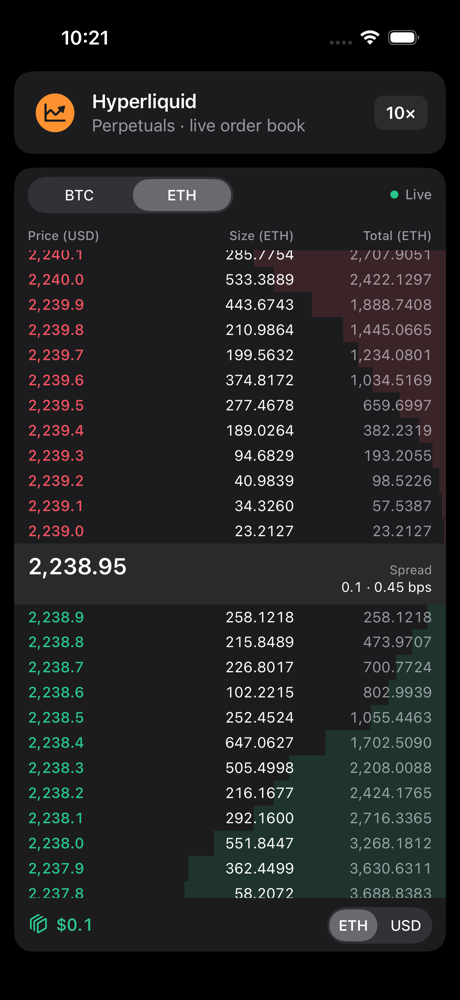
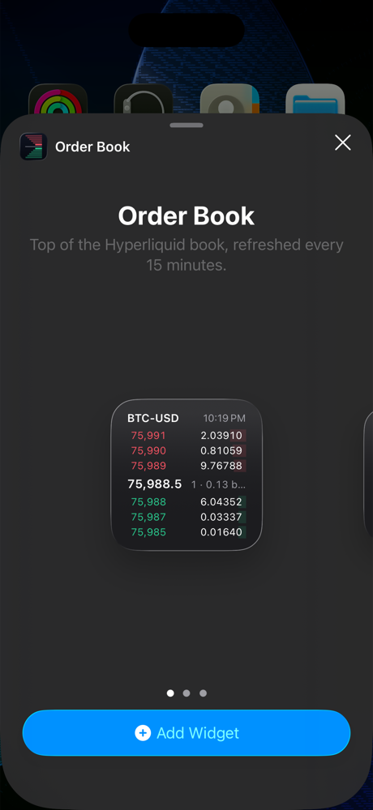

# Hyperliquid Order Book Widget

[](https://github.com/alexjhoff/hyperliquid-orderbook-widget/actions/workflows/ci.yml)

A native SwiftUI order book widget for Hyperliquid perpetuals, streaming the `l2Book` websocket feed
live. Built for the Fullstack Mobile take-home. "Widget" in both senses: a reusable in-app component
that any screen can drop in, and a real Home Screen widget.

<p>
  
  
</p>

## Embedding it

```swift
import OrderBookWidget

struct TradeScreen: View {
    var body: some View {
        OrderBookWidget()   // owns its connection, state and controls; fills the frame it is given
    }
}
```

That is the package's whole public surface, plus `Symbol` and the snapshot types the Home Screen
widget renders. The demo app embeds it under a market header card, the way a trading app would.

## What it does

- **Live book.** 20 levels per side from `wss://api.hyperliquid.xyz/ws`, asks above the spread, bids
  below, in one natively scrolling column centred on the spread. Tap the spread to recentre.
- **Native controls.** A segmented picker for BTC/ETH, a menu picker for price grouping (`nSigFigs`,
  labelled by the tick it produces: $0.1, $1, $10, ...), and a coin/USD size toggle. All persist.
- **Change feedback.** Rows flash green when size grows, red when it shrinks, white for a new level.
  The mid price rolls with a numeric transition and takes the colour of its last move. The status
  label switches to "3s ago" when the market goes quiet, so the feed never looks frozen.
- **Information density.** A cumulative depth bar behind every row, so walls stand out; spread in
  price and basis points.
- **Haptics** for user actions only: picker changes and recentring. Market data never buzzes.
- **Connection states.** Retry countdown in the header and a dimmed book while its data is stale.
- **Home Screen widget.** Top of the book in small, medium and large, refreshed by iOS roughly every
  15 minutes from the REST `info` endpoint. Market and grouping are configurable from the widget's
  edit sheet; tapping it opens the live book on that market.
- **Accessibility.** One VoiceOver label per row and for the spread, Reduce Motion disables flashes
  and transitions, Dynamic Type up to xxLarge.

## Architecture

MVVM with dependency injection. Business logic lives in small, view-free types behind protocols;
the view model takes its dependencies through `init`; views only render values.

```
OrderBookWidget (public View)
  └─ OrderBookViewModel (@MainActor @Observable)   selections, book, status
       ├─ any OrderBookFeed ── HyperliquidFeed (actor)   reconnect, heartbeat, ack-gated subscription
       │     ├─ any SocketTransport ── URLSessionSocket
       │     └─ SnapshotBuilder + BookFormatter (pure)   totals, diff, labels, off the main thread
       └─ any SelectionStoring ── UserDefaultsSelectionStore
```

| Folder | Holds |
| --- | --- |
| `Models` | `Symbol`, `Precision`, `BookSubscription`, `BookSnapshot`, `BookLevel`, `ConnectionStatus` |
| `Domain` | `SnapshotBuilder`, `BookFormatter`, `ReconnectPolicy`, `StatusPresentation`, `PrecisionPresentation`, `DeepLink`, `BookRefresher` |
| `Networking` | wire messages, `SocketTransport`, `OrderBookFeed`, `HyperliquidFeed`, `HyperliquidInfoClient` |
| `Persistence` | `SelectionStoring` with UserDefaults and in-memory stores |
| `ViewModels` | `OrderBookViewModel` |
| `Views` | header, column header, list, side, row, depth bar, spread row, footer, `A11yID`, preview feed |
| `Views/Tokens` | `Spacing`, `Radius`, `Opacity`, `Motion`, `Layout`, `Glyph`, `Palette` |
| `Resources` | String Catalog, privacy manifest |
| `WidgetExtension/` | `BookWidget`, its intent configuration, timeline provider and entry view |
| `Demo/` | `TradeScreen` |

Every seam is a protocol with a fake: `FakeFeed` and `InMemorySelectionStore` drive the view model
in tests, `PreviewFeed` drives previews, and `HyperliquidInfoClient` takes its request transport as
a closure.

### Feed notes

- Every `l2Book` message is a full snapshot, so there is no delta or sequence state to repair.
- Frames do not say which grouping they carry. The feed unsubscribes the old grouping, waits for the
  ack, subscribes the new one, and admits book frames only while the confirmed subscription matches
  the wanted one. Snapshots are stamped with their subscription and the view model drops any that
  arrive late for a superseded one.
- Hyperliquid closes idle sockets after 60 s; the feed pings every 20 s and reconnects after 30 s of
  silence, with exponential backoff from 0.5 s to 10 s, jittered.
- The Home Screen widget cannot hold a socket. It posts `{"type":"l2Book","coin":...}` to
  `api.hyperliquid.xyz/info`, which returns the same payload, through the same decoder and builder.

### Performance

Decoding, parsing, cumulative sums, formatting and diffing all run in the feed actor; the main actor
does one property assignment per update. Rows are keyed by Hyperliquid's price string and are
`Equatable`, with bar fractions rounded to 1/512 so a row whose bar would not visibly move skips
`body`. Depth bars animate with `scaleEffect` and flashes are keyframe opacity animations, so neither
triggers layout. The socket closes when the app is backgrounded and reconnects on return.

## Tests

```bash
cd OrderBookWidget && xcodebuild test -scheme OrderBookWidget -destination 'platform=iOS Simulator,name=iPhone 17 Pro'
```

Basic by design, one small file per seam, with the feed driven by a scripted socket and a hand-advanced clock:

| Suite | Covers |
| --- | --- |
| `WireMessagesTests` | Decoding captured frames, acks, pong, errors; encoding subscribe/unsubscribe |
| `BookFormatterTests` | Fixed decimals, compact dollars, price decimals per grouping, tick labels |
| `SnapshotBuilderTests` | Totals, depth fractions, mid, spread, bps, change classification, trend, reset, malformed input |
| `ReconnectPolicyTests` | Backoff schedule, cap, jitter bounds |
| `StatusPresentationTests` | Live, quiet, and retry countdown labels |
| `OrderBookViewModelTests` | Defaults from the store, applying matching snapshots, rejecting stale ones, persisting and resubscribing, feed call ordering, closing the socket when the view goes away |
| `HyperliquidFeedTests` | Connect and subscribe, the unsubscribe-then-subscribe handshake, reconnect with backoff, pings and the silence timeout |
| `HyperliquidInfoClientTests` | The REST request and a captured response |
| `BookRefresherTests` | The Home Screen widget's refresh interval after success and after failure |
| `DeepLinkTests` | URL round trip and rejected links |

## Logging

`os.Logger`, subsystem `com.alexhoff.OrderBookWidget`, categories `feed`, `model` and `widget`.
Connection lifecycle, backoff, subscribe and ack, server errors, undecodable frames and widget
fetches. Filter in Console.app with `subsystem:com.alexhoff.OrderBookWidget`.

## Project setup

- Xcode 26, iOS 26. Swift 6 language mode, strict concurrency, warnings as errors.
- `OrderBookDemo.xcodeproj` is generated from `project.yml` with [XcodeGen](https://github.com/yonaskolb/XcodeGen)
  and committed, so opening it needs no extra tools. After editing `project.yml`, run `xcodegen generate`.
  CI fails if the committed project drifts from it.
- Formatting: `xcrun swift-format lint --strict --recursive OrderBookWidget/Sources OrderBookWidget/Tests Demo WidgetExtension`.
- Strings live in a String Catalog per target, and each target ships a privacy manifest declaring its `UserDefaults` use.
- Signing: put your team in the untracked `Config/Local.xcconfig`:

```bash
echo 'DEVELOPMENT_TEAM = ABCDE12345' > Config/Local.xcconfig
```

TestFlight: `Scripts/archive.sh` archives a Release build and uploads it to App Store Connect.

## Decisions

- **A package, not a view in an app.** The compiler enforces the widget's boundary: the host sees one
  view and nothing of the feed, store or formatting.
- **Two meanings of widget, both real.** WidgetKit cannot stream, scroll, animate or give haptics, so
  the in-app component carries those requirements and the Home Screen widget is a periodic glance.
- **Replace the whole snapshot rather than apply deltas.** The feed only sends full snapshots.
- **Reconcile subscriptions rather than track a flag.** The only proof a frame is the right one is
  that the server has confirmed the current subscription and nothing else is pending.
- **Foundation `FormatStyle`.** About 200 strings per snapshot, off the main thread; a custom
  formatter is not worth its lines here.
- **iOS 26 only.** No installed base to support, and it keeps the code free of availability checks.
- **No dependencies.** `URLSessionWebSocketTask`, `WidgetKit`, `AppIntents` and `os` cover it.

## Known limitations

- Market data only; no order entry or account data.
- Depth is the 20 levels per side the feed provides.
- The Home Screen widget shows "Couldn't reach Hyperliquid" after a failed fetch and retries in five
  minutes rather than keeping the previous book.
- Opening the app from the widget on another market rebuilds the in-app widget, which reconnects.

## AI usage

Built with Claude Code as a pair programmer, which the brief allows. Every file was reviewed, the
design is documented above, and the aim was a small, dependency-free codebase: about 1,800 lines in
the package, 200 in the extension, 100 in the demo and 800 of tests.
